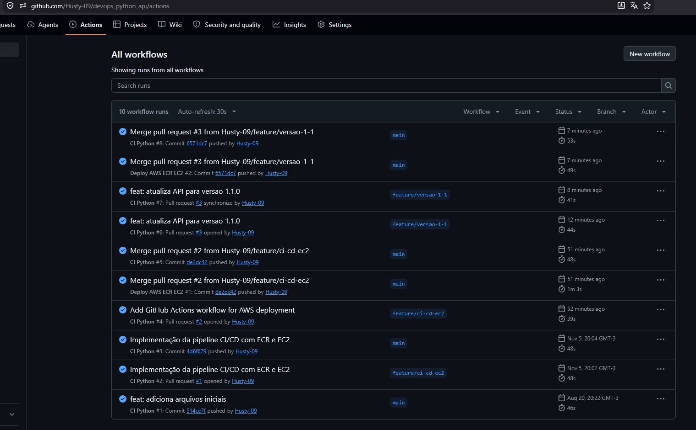
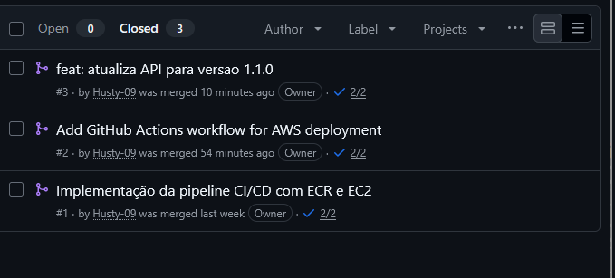
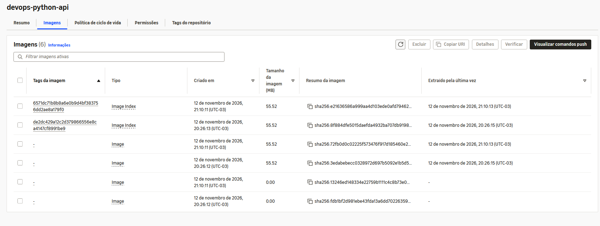
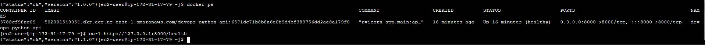
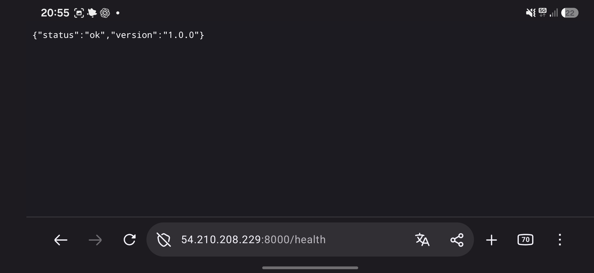
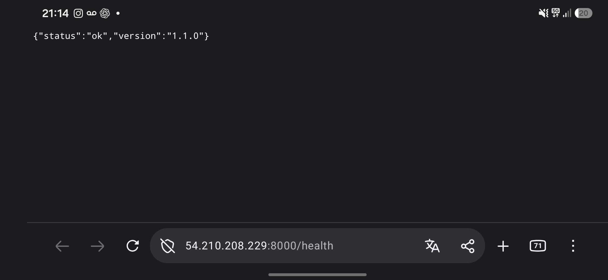

# API Python para demonstrar DevOps

Repositório didático para apresentar, em uma única aplicação, três ideias que se conectam:

1. uma API HTTP escrita em Python;
2. integração contínua com GitHub Actions;
3. execução reproduzível com Docker.

O projeto utiliza FastAPI, pytest, Ruff, GitHub Actions e Docker. Os dados ficam em memória para manter a atenção da aula no fluxo DevOps, sem introduzir banco de dados.

## O que os estudantes devem observar

- O código funciona localmente e no runner do GitHub.
- A mesma suíte de testes é executada pelo desenvolvedor e pelo pipeline.
- O Dockerfile descreve o ambiente necessário para executar a API.
- O pipeline só testa o container depois que qualidade e testes foram aprovados.
- Logs, cobertura e relatórios funcionam como evidências, não apenas como mensagens coloridas.

## Estrutura do repositório

```text
.
├── .github/workflows/ci.yml   # pipeline de integração contínua
├── app/
│   ├── __init__.py
│   └── main.py                # API FastAPI
├── docs/
│   ├── API.md
│   ├── DOCKER.md
│   ├── GITHUB-ACTIONS.md
│   └── ROTEIRO-AULA.md
├── tests/test_api.py          # testes automatizados
├── .dockerignore
├── .python-version
├── compose.yaml
├── Dockerfile
├── pyproject.toml             # configuração de pytest, cobertura e Ruff
├── requirements.txt           # dependências de execução
└── requirements-dev.txt       # dependências de desenvolvimento e CI
```

## 1. Executar localmente

Pré-requisitos: Git e Python 3.13.

### Linux e macOS

```bash
python3 -m venv .venv
source .venv/bin/activate
python -m pip install --requirement requirements-dev.txt
uvicorn app.main:app --reload
```

### Windows PowerShell

```powershell
py -3.13 -m venv .venv
.venv\Scripts\Activate.ps1
python -m pip install --requirement requirements-dev.txt
uvicorn app.main:app --reload
```

Acesse:

- API: <http://localhost:8000>
- documentação Swagger: <http://localhost:8000/docs>
- verificação de saúde: <http://localhost:8000/health>

## 2. Experimentar a API

```bash
curl http://localhost:8000/health

curl -X POST http://localhost:8000/tasks \
  -H "Content-Type: application/json" \
  -d '{"title":"Estudar integração contínua"}'

curl http://localhost:8000/tasks

curl -X PATCH http://localhost:8000/tasks/1/done
```

Endpoints:

| Método | Caminho | Objetivo | Resposta esperada |
|---|---|---|---|
| GET | `/` | Apresentar a API | `200` |
| GET | `/health` | Informar saúde e versão | `200` |
| GET | `/tasks` | Listar tarefas | `200` |
| POST | `/tasks` | Criar uma tarefa | `201` |
| PATCH | `/tasks/{id}/done` | Concluir uma tarefa | `200` ou `404` |

Veja a explicação do código em [docs/API.md](docs/API.md).

## 3. Executar as verificações locais

```bash
ruff check .
ruff format --check .
pytest --cov=app --cov-report=term-missing
```

Esses comandos são deliberadamente iguais aos usados no GitHub Actions. Se uma verificação falhar localmente, ela também deverá falhar no pipeline.

Para aplicar a formatação automaticamente:

```bash
ruff format .
```

## 4. Publicar no GitHub e acionar a CI

O diretório já é inicializado como repositório Git local. Crie um repositório vazio no GitHub e execute:

```bash
git remote add origin https://github.com/SEU-USUARIO/devops-python-api.git
git push -u origin main
```

O arquivo `.github/workflows/ci.yml` dispara o pipeline em três situações:

- `push` na branch `main`;
- `pull_request` destinado à `main`;
- execução manual pela aba **Actions**.

Na aba **Actions**, abra a execução e faça a leitura nesta ordem:

1. workflow;
2. job;
3. primeiro step que falhou;
4. comando e mensagem que explicam a falha.

A explicação detalhada do YAML está em [docs/GITHUB-ACTIONS.md](docs/GITHUB-ACTIONS.md).

## 5. Executar com Docker

```bash
docker build -t devops-python-api:v1 .
docker run --rm -p 8000:8000 --name devops-python-api devops-python-api:v1
```

Em outro terminal:

```bash
curl http://localhost:8000/health
docker ps
docker logs devops-python-api
```

Com Docker Compose:

```bash
docker compose up --build
docker compose down
```

Veja a leitura detalhada do Dockerfile em [docs/DOCKER.md](docs/DOCKER.md).

## Falhas intencionais para demonstrar

### Falha de teste

Em `app/main.py`, altere temporariamente a versão do health check para `2.0.0`. O teste espera `1.1.0`, então o pytest e o pipeline devem falhar.

### Falha de qualidade

Adicione um import não utilizado no início de `app/main.py`:

```python
import os
```

O step `ruff check .` localizará o problema.

### Falha de rede no container

No `Dockerfile`, troque `--host 0.0.0.0` por `--host 127.0.0.1`. O processo iniciará, mas o serviço não ficará acessível pela porta publicada no host.

## Próximos desafios

- Adicionar um endpoint `DELETE /tasks/{id}` e seus testes.
- Executar os testes em uma matriz com Python 3.12, 3.13 e 3.14.
- Publicar a imagem em um registry somente após a aprovação dos testes.
- Substituir o armazenamento em memória por um banco de dados.

## Referências oficiais

- [GitHub Actions: criar e testar Python](https://docs.github.com/pt/actions/tutorials/build-and-test-code/building-and-testing-python)
- [actions/checkout](https://github.com/actions/checkout)
- [actions/setup-python](https://github.com/actions/setup-python)
- [actions/upload-artifact](https://github.com/actions/upload-artifact)
- [FastAPI](https://fastapi.tiangolo.com/)
- [Docker para Python](https://docs.docker.com/language/python/)

---

## Arquitetura CI/CD na AWS

Este projeto implementa integração e entrega contínuas usando GitHub Actions, Docker, Amazon ECR, Amazon EC2 e AWS Systems Manager.

### Fluxo automatizado

1. O desenvolvedor cria uma branch e abre um Pull Request para main.
2. O GitHub Actions executa verificações Ruff, testes pytest e cobertura.
3. Após aprovação e merge, o workflow deploy.yml é iniciado.
4. Os testes são executados antes de qualquer publicação.
5. Uma imagem Docker é construída e identificada pelo SHA do commit.
6. A imagem é publicada no Amazon ECR privado.
7. O AWS Systems Manager envia comandos à EC2.
8. A EC2 baixa a imagem, substitui o contêiner e verifica /health.

### Infraestrutura

| Componente | Configuração |
|---|---|
| Região AWS | us-east-1 |
| Amazon ECR | devops-python-api |
| Amazon EC2 | Amazon Linux 2023 |
| Tipo de instância | t3.micro |
| Porta HTTP | 8000 |
| Gerenciamento remoto | AWS Systems Manager |
| Autenticação EC2 | IAM Role LabRole |

### Workflows

**Integração contínua:** .github/workflows/ci.yml

Responsável por validar Pull Requests com análise estática, formatação, testes automatizados, cobertura e teste do contêiner.

**Entrega contínua:** .github/workflows/deploy.yml

Executado após atualizações da branch main. Realiza testes, construção da imagem, publicação no ECR e implantação automática na EC2 via SSM.

### Acesso à aplicação

Endpoint: http://54.210.208.229:8000/health

Documentação Swagger: http://54.210.208.229:8000/docs

O IPv4 público pode mudar quando a instância é interrompida e reiniciada.

### Evidências da automação

Primeiro deploy:
https://github.com/Husty-09/devops_python_api/actions/runs/43328734810

Segundo deploy:
https://github.com/Husty-09/devops_python_api/actions/runs/43334790582

CI da atualização:
https://github.com/Husty-09/devops_python_api/actions/runs/43334592186

### Pull Requests

PR #1 - Testes:
https://github.com/Husty-09/devops_python_api/pull/1

PR #2 - Deploy AWS:
https://github.com/Husty-09/devops_python_api/pull/2

PR #3 - Atualização 1.1.0:
https://github.com/Husty-09/devops_python_api/pull/3

### Verificar a versão implantada

Execute:

curl http://IP_PUBLICO:8000/health

A resposta esperada após o segundo deploy é:

{"status":"ok","version":"1.1.0"}

### Limitações e segurança

- As tarefas são armazenadas em memória e desaparecem quando o contêiner é substituído.
- O laboratório Vocareum utiliza credenciais AWS temporárias.
- A automação depende da validade dessas credenciais e da disponibilidade da EC2.
- As credenciais são configuradas nos GitHub Actions Secrets.
- A aplicação é exposta via HTTP para demonstração acadêmica.
- O deploy atual não implementa rollback automático.
- Os recursos AWS devem ser interrompidos ou excluídos após a avaliação.

## Evidências da implementação CI/CD

As imagens abaixo demonstram a integração contínua, os Pull Requests e a implantação automática na AWS.

### 1. Integração contínua


### 2. Pull Requests e merges


### 3. Deploys automáticos


### 4. Imagens Docker no ECR


### 5. Primeira versão - 1.0.0


### 6. Segunda versão - 1.1.0


### Resultado

A API foi implantada inicialmente na versão 1.0.0.

Após a aprovação dos testes e o merge na main,
o GitHub Actions publicou uma nova imagem no Amazon ECR
e atualizou automaticamente a EC2 para a versão 1.1.0.

